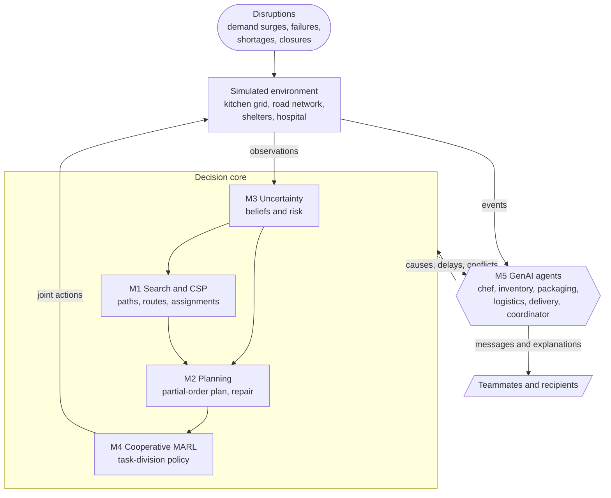
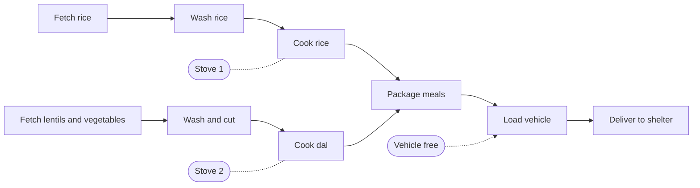
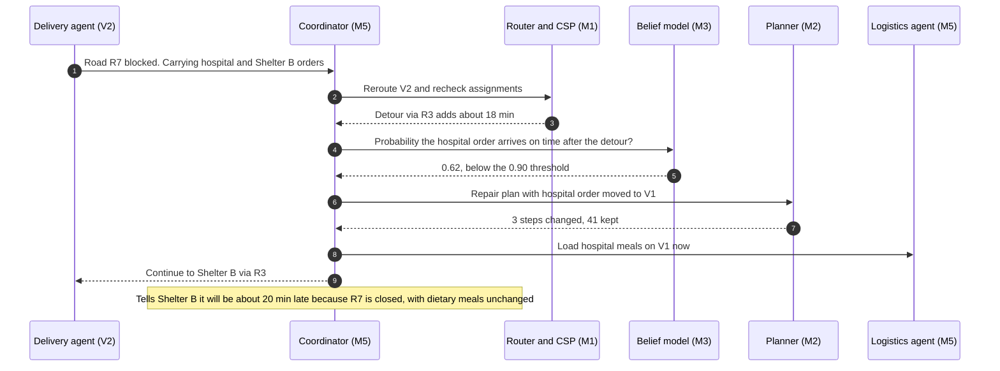

# Collaborative Emergency Kitchen & Relief-Supply System

A multi-agent AI system that prepares, packages and delivers relief meals after a disaster, and keeps working when demand jumps, a stove fails, rice runs short or a road closes.


Semester-wide project for the **Artificial Intelligence** course at IIT Bhubaneswar, Group 14.

## Why this project

Running a relief kitchen after a cyclone or earthquake is a coordination problem in which almost everything moves. Work has hard dependencies: ingredients are prepared before they are cooked, meals are cooked before they are packed, and a delivery cannot leave until enough *suitable* meals are ready. Stoves, counters, vehicles and corridors are shared. Meanwhile new requests arrive, equipment breaks, stock records prove wrong and roads close, so any allocation or schedule fixed at the start soon stops being valid.

This project builds a team of robot or human-like agents that run such a kitchen and its delivery network together. They divide the work, move without colliding, respect dietary and food-safety rules, recover from failures, revise plans as conditions change, ask teammates for help, and explain why an order was delayed, modified or prioritised.

Meals delivered is not the only objective. The system is also judged on **urgency, fairness across shelters, dietary correctness, food wastage, delivery delay, workload balance and safety**.

### The scenario it has to handle

| # | Event | What the system must do | Modules |
|---|---|---|---|
| 1 | An order for 200 meals arrives | Assign tasks, stations and vehicles; build the plan | M1, M2 |
| 2 | A shelter reports 80 more people | Revise the demand estimate; re-allocate ingredients and cooking slots | M3, M1 |
| 3 | One cooking station fails | Move its tasks to working stoves, repairing only the affected part of the plan | M2, M4 |
| 4 | Rice runs short | Confirm the shortage; propose a substitute that respects every diet | M3, M5, M1 |
| 5 | A delivery road is blocked | Reroute, update arrival estimates, re-prioritise loads | M1, M3 |
| 6 | Some recipients need allergen-free or diabetic-friendly meals | Enforce these as hard constraints through cooking, packing and dispatch | M1 |
| 7 | A hospital must be served before less urgent sites | Priority-aware allocation and dispatch | M1, M4 |
| 8 | An order can't be met as requested | Explain the cause, name the affected recipients, offer a safe alternative | M5 |

## Architecture

Five modules share one simulated environment. The decision core (M1–M4) produces the feasibility checks, plans, risk estimates and actions; the GenAI layer (M5) coordinates, communicates and explains by calling the core rather than improvising.



## Modules

| Module | Answers | Produces |
|---|---|---|
| **M1** Search & CSP | Who does what, on which station, by which path? Is an order feasible at all? | Collision-free paths, delivery routes, task and resource assignments, causes of infeasibility |
| **M2** Planning | In what order, using which shared resources? | Partial-order plan, resource schedule, repaired plans |
| **M3** Uncertainty | How sure are we about stock, equipment, durations and demand? | Beliefs, success probabilities, contingency options |
| **M4** Cooperative MARL | How should agents divide and switch work as things change? | Learned task-division policy |
| **M5** Generative AI | Who needs to know what, and why did the plan change? | Coordination messages, replan triggers, explanations for recipients |

### M1 — Search and constraint satisfaction

- **Graphs.** The kitchen, storage and packaging areas form a grid (occupancy) graph; the delivery network is a weighted road graph whose edges can close; each recipe is a task-dependency DAG.
- **Paths and routes.** A\* for single agents; multi-agent path finding (prioritised planning, with Conflict-Based Search as the optimal variant) for collision-free movement in shared corridors; shortest-path routing on the road graph, recomputed when a road closes. Search also locates the nearest available ingredient or piece of equipment.
- **CSP.** Variables cover *task → agent, station, time slot* and *order → meal variant, vehicle, departure*. Constraints cover dietary requirements, ingredient stock, equipment capacity, agent skills, preparation deadlines, workspace occupancy and collision avoidance, food-safety rules (e.g. allergen separation, maximum holding time for cooked food) and delivery priority.
- **Infeasibility diagnosis.** Every constraint is tagged with a category: ingredients, equipment, staff, time or transport. When an order has no solution, a minimal conflicting set of constraints is extracted (QuickXplain-style), so the report says *why*, e.g. "order 12: transport (only route blocked) + time (deadline 14:00)".

### M2 — Planning

- **Actions** have preconditions, effects, a duration and required resources. Example: `Cook(rice, stove)` needs `Washed(rice)` and a free stove, produces `Cooked(rice)`, and takes about 25 minutes.
- **Partial-order planner** with causal links and threat resolution (promotion/demotion), so only necessary orderings are imposed and independent work runs in parallel.
- **Resource scheduling** maps the partial order onto stoves, preparation counters, packaging areas and vehicles.
- **Plan repair.** A disruption (missing ingredient, failed stove, urgent order, blocked route) invalidates specific causal links and resource assignments. Only that part of the plan is retracted and re-planned; full replanning is the fallback.



*Example meal plan. The rice and dal branches have no ordering constraint between them, so they run in parallel on two stoves; packaging waits for both, and loading also needs a free vehicle.*

### M3 — Reasoning under uncertainty

- **Beliefs** over ingredient stock (records may be stale), equipment reliability, cooking and travel durations, and future demand (shelter head counts are approximate).
- **Bayesian updating** whenever new observations arrive, e.g. Beta–Bernoulli models for equipment failure and a Bayesian network linking road conditions to travel time.
- **Risk estimates.** Monte Carlo rollouts of the current plan give the probability that each order finishes on time and that stock will suffice. High-risk tasks get a contingency: a backup stove, a substitute ingredient, an alternate route or vehicle.
- **Provenance.** Every fact is tagged `confirmed` (an observed shortage), `estimated` (uncertain current inventory) or `forecast` (predicted future demand), and the tag travels with it into plans, rewards and explanations.

### M4 — Cooperative multi-agent reinforcement learning

- **Formulation.** A Dec-POMDP. Each agent sees its local surroundings, the shared task board from M2 and recent messages, and chooses to collect ingredients, prepare food, operate equipment, package meals, transport supplies, assist a teammate, clear a shared path, switch task, or wait.
- **Action masking.** An agent can only pick tasks that M2 marks as ready and M1's constraints allow, so learning focuses on who takes which ready task, when to help, and when to switch.
- **Algorithms.** Independent Q-learning first, then value decomposition (VDN, QMIX) and a centralised-critic actor–critic (MAPPO), all trained centrally and executed decentrally.
- **Baselines.** Fixed task allocation, greedy nearest-task selection, and independent agents with no coordination.

Shared team reward (weights to be tuned experimentally):

| Rewarded | Penalised |
|---|---|
| Meals completed correctly | Collisions or blocking a shared path |
| On-time delivery, weighted by priority | Duplicated work |
| Dietary requirements met | Food wastage |
| Efficient use of stations and vehicles | Wrong meals or dietary violations |
| Balanced workload across agents | Missed deadlines, scaled by lateness and priority |
| Service to high-priority recipients | Idle resources while tasks wait |
| | Unfair distribution across shelters |

### M5 — Generative AI

- **Role agents:** chef, inventory, packaging, logistics, delivery and a coordinator, each an LLM with a role prompt and a restricted set of tools.
- **Grounded decisions.** Agents call M1–M4 for feasibility, plans, risk and task choice. The environment validates every proposed action, and anything that fails validation is rejected rather than executed.
- **Concise messages.** Short structured messages on a shared channel instead of re-describing the whole environment, for example:

  ```json
  {
    "from": "inventory",
    "to": "coordinator",
    "type": "alert",
    "fact": "rice_stock",
    "status": "confirmed",
    "detail": "18 kg left, orders 3-5 need 30 kg",
    "proposal": "substitute millet for orders 4-5, no dietary conflicts"
  }
  ```

- **Explanations.** When an order can't be met as requested, the coordinator states the cause (from M1's diagnosis and M3's evidence), the affected recipients, and a safe alternative.

## Putting it together: a road closure

How the modules interact when a delivery road closes mid-run (illustrative numbers):



## Simulation environment

| Entity | Attributes |
|---|---|
| Agents | Role, skills, position, carried item, current task |
| Stations (storage, preparation counters, stoves, packaging) | Location, capacity, working or failed, current occupant |
| Ingredients | Quantity with confidence, allergens, shelf life |
| Recipes | Task DAG, durations, dietary tags (vegetarian, allergen-free, diabetic-friendly) |
| Orders | Destination, meal count per dietary type, deadline, priority |
| Vehicles and roads | Capacity and position; road edges with travel time and open or blocked status |
| Destinations | Shelters (approximate head count), hospital (medical priority) |

Scenarios are YAML files describing the map, agents, stock, orders and a timeline of events, and are run with fixed seeds for reproducibility. The environment follows the PettingZoo parallel API so the MARL code can use standard tooling.

**Disruptions modelled:** demand surges, ingredient shortages, equipment failures, unavailable staff, blocked passages inside the kitchen, road closures, urgent medical orders and communication failures.

## Evaluation

Every scenario is run under several setups:

| Setup | Description |
|---|---|
| Full system | All five modules, coordinated |
| Independent agents | The same agents with no coordination or communication |
| Fixed allocation | Tasks assigned once at the start and never revised |
| Greedy nearest-task | Each agent takes the closest unclaimed task |
| Ablations | No plan repair (replan from scratch), no uncertainty model (point estimates), no messages |

Scenarios cover demand surges, ingredient shortages, equipment failures, unavailable staff, blocked passages, road closures, urgent medical orders, dietary restrictions, communication failures, and the combined scenario above. The central question is whether the system recovers when its original allocation or plan stops being valid.

| Metric | How it is measured |
|---|---|
| Meal-completion rate | Valid meals delivered ÷ meals requested |
| Deadline satisfaction | Share of orders delivered by their deadline |
| Average delivery delay | Mean lateness per order (0 if on time) |
| Dietary violations | Delivered meals that break a recipient's constraint (target: 0) |
| Food wastage | Meals or opened ingredients not delivered before they expire |
| Collision rate | Collisions per 100 agent moves |
| Resource utilisation | Busy time ÷ available time, per station and vehicle |
| Idle time and workload balance | Idle share per agent; coefficient of variation of busy time |
| Replanning efficiency | Repair time and share of the original plan kept |
| Communication overhead | Messages (and LLM tokens) per completed order |
| Fairness | Jain's index over shelters' fulfilment ratios (below) |

```math
J = \frac{\left(\sum_{i=1}^{n} x_i\right)^2}{n \sum_{i=1}^{n} x_i^2},
\qquad x_i = \frac{\text{meals delivered to shelter } i}{\text{meals needed at shelter } i}
```

$J = 1$ when every shelter receives the same share of its need, and it falls toward $1/n$ as supply concentrates on a single site.

## Repository structure (planned)

```text
collaborative-relief-kitchen/
├── configs/
│   └── scenarios/          # YAML scenarios: base, demand surge, road closure, ...
├── relief_kitchen/
│   ├── env/                # simulator: kitchen grid, road network, event generator
│   ├── search_csp/         # M1: path finding, routing, CSP, infeasibility diagnosis
│   ├── planning/           # M2: partial-order planner, scheduler, plan repair
│   ├── uncertainty/        # M3: belief models, risk estimates, contingencies
│   ├── marl/               # M4: environment wrapper, training, policies, baselines
│   ├── genai/              # M5: role agents, coordinator, message bus
│   └── evaluation/         # metrics, experiment runner, plots
├── notebooks/              # exploration and result analysis
├── tests/
├── docs/                   # report, diagrams, interface notes
├── requirements.txt
└── README.md
```

## Getting started

> [!NOTE]
> The project is in early development. The commands below describe the intended interface and will start working as each module lands.

```bash
git clone https://github.com/<your-username>/collaborative-relief-kitchen.git
cd collaborative-relief-kitchen
python -m venv .venv
source .venv/bin/activate        # Windows: .venv\Scripts\activate
pip install -r requirements.txt
```

Planned entry points:

```bash
# Run one scenario end to end
python -m relief_kitchen.run --scenario configs/scenarios/road_closure.yaml

# Train the MARL policy
python -m relief_kitchen.marl.train --algo qmix --scenario configs/scenarios/base.yaml

# Compare all setups across all scenarios
python -m relief_kitchen.evaluation.compare --methods full independent fixed greedy
```

M5 needs an LLM with tool calling (a hosted API or a local model); configuration will be documented with that module.

### Tech stack (planned)

| Area | Tools |
|---|---|
| Core and graphs | Python, NumPy, [NetworkX](https://networkx.org/) |
| CSP | Own backtracking solver; [OR-Tools CP-SAT](https://developers.google.com/optimization) to cross-check larger instances |
| Probabilistic reasoning | [pgmpy](https://pgmpy.org/), SciPy |
| MARL | PyTorch, [PettingZoo](https://pettingzoo.farama.org/) parallel API |
| GenAI | An LLM with tool calling, hosted or local |
| Evaluation | pandas, Matplotlib, pytest |

## Roadmap

- [ ] **Environment:** kitchen grid, road network, scenario format, event generator, PettingZoo wrapper
- [ ] **M1:** A\* and multi-agent paths, road routing, CSP model, infeasibility diagnosis
- [ ] **M2:** action schema, partial-order planner, resource scheduling, local plan repair
- [ ] **M3:** belief models, on-time and stock-sufficiency probabilities, provenance tags, contingencies
- [ ] **M4:** reward design, IQL baseline, VDN / QMIX / MAPPO, comparison with heuristic baselines
- [ ] **M5:** role agents, message protocol, coordinator replanning loop, explanations
- [ ] **Integration:** full pipeline on the combined scenario
- [ ] **Evaluation and report:** all scenarios × all setups, ablations, final report and demo

## Team

| Module | Owner |
|---|---|
| M1 Search and CSP | _TBD_ |
| M2 Planning | _TBD_ |
| M3 Reasoning under uncertainty | _TBD_ |
| M4 Cooperative MARL | Gowtham Jothiramalingam |
| M5 Generative AI | _TBD_ |
| Integration and evaluation | _TBD_ |

## References

From the project brief:

1. Sun, H., Zhang, S., Niu, L., et al. (2025). *Collab-Overcooked: Benchmarking and evaluating large language models as collaborative agents.* Proceedings of EMNLP 2025, pp. 4922–4951. [Paper](https://aclanthology.org/2025.emnlp-main.249/) · [Code](https://github.com/YusaeMeow/Collab-Overcooked)
2. Schröder, F., Heinrich, F., & Kopp, S. (2025). *Towards fluid human-agent collaboration: From dynamic collaboration patterns to models of theory of mind reasoning.* Frontiers in Robotics and AI, 12, 1532693. [DOI](https://doi.org/10.3389/frobt.2025.1532693) · [Cooperative Cuisine code](https://gitlab.ub.uni-bielefeld.de/scs/cocosy/cooperative-cuisine)
3. Yu, L., et al. (2021). *Reinforcement learning approach for resource allocation in humanitarian logistics.* Expert Systems with Applications, 173, 114663. [DOI](https://doi.org/10.1016/j.eswa.2021.114663)

Methods:

4. Sharon, G., Stern, R., Felner, A., & Sturtevant, N. R. (2015). *Conflict-based search for optimal multi-agent pathfinding.* Artificial Intelligence, 219, 40–66. [DOI](https://doi.org/10.1016/j.artint.2014.11.006)
5. Sunehag, P., et al. (2018). *Value-decomposition networks for cooperative multi-agent learning.* AAMAS 2018. [arXiv:1706.05296](https://arxiv.org/abs/1706.05296)
6. Rashid, T., et al. (2018). *QMIX: Monotonic value function factorisation for deep multi-agent reinforcement learning.* ICML 2018. [arXiv:1803.11485](https://arxiv.org/abs/1803.11485)
7. Yu, C., et al. (2022). *The surprising effectiveness of PPO in cooperative multi-agent games.* NeurIPS 2022 Datasets and Benchmarks Track. [arXiv:2103.01955](https://arxiv.org/abs/2103.01955)
8. Russell, S., & Norvig, P. *Artificial Intelligence: A Modern Approach* (4th ed.). Pearson. Background for search, CSPs, planning and probabilistic reasoning.
