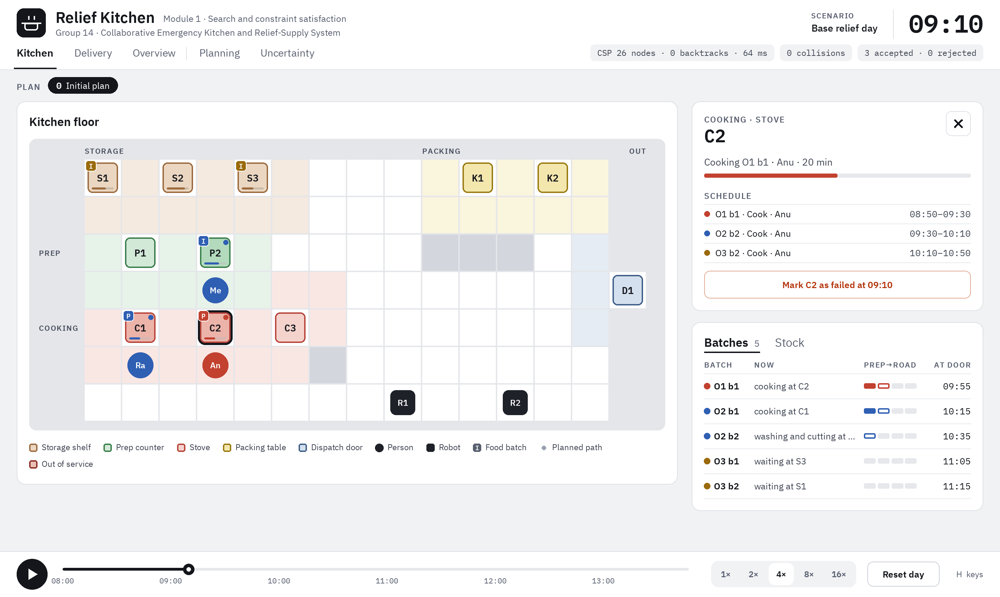
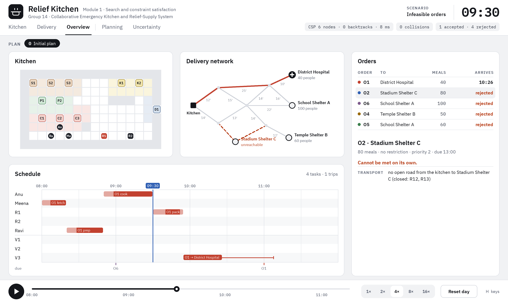
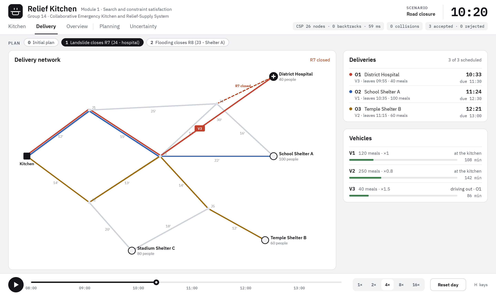
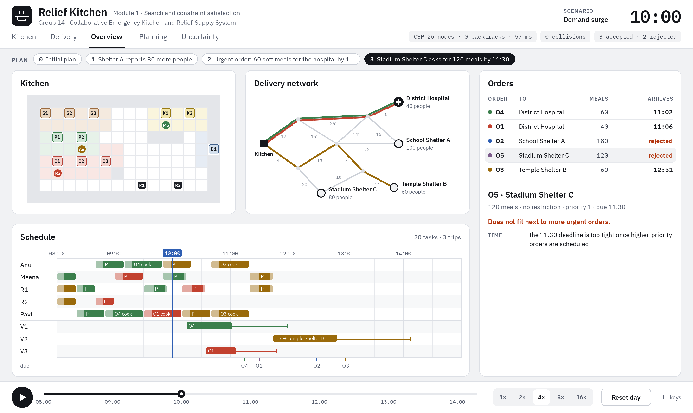

# Module 1: Search and Constraint Satisfaction

Module 1 decides who does what, on which station, by which path, and with which vehicle. It also
decides whether each order can be met, and if not, why. All algorithms are written from scratch.
Every technique below is either a CS 188 topic or basic graph theory.

The code is in three parts:

| Part | Folder | What |
|---|---|---|
| 1. Visualiser | `relief_kitchen/viz/` | Pygame pages (for Modules 1–3), drawing helpers, input |
| 2. Algorithms (present these) | `relief_kitchen/algorithms/` | `grid_search`, `mapf`, `routing`, `csp`, `kitchen_csp`, `diagnosis`, `planner` |
| 3. Support | `relief_kitchen/support/` | Environment (`env/`), records, CSP-building and model helpers, motion, food flow, report, CLI |

Modules 2 and 3 have their own folders, `relief_kitchen/planning/` and `relief_kitchen/uncertainty/`.
See [module2.md](module2.md) (partial-order planning) and [module3.md](module3.md) (reasoning under
uncertainty). [scenarios.md](scenarios.md) explains every scenario step by step.



## 1. Graphs

| Graph | Nodes / edges | File |
|---|---|---|
| Kitchen grid | Floor cells, 4-connected. Shelves `S`, prep counters `P`, stoves `C`, packing tables `K` and the door `D` are not walkable; each is used from its *access cell*. | `support/env/kitchen_grid.py` |
| Road network | Kitchen, junctions, shelters and the hospital; weighted by travel minutes; roads can close | `support/env/road_network.py` |
| Task-dependency DAG | Per order: batches of ≤ 50 meals, each running `fetch → prep → cook → pack`. Every pack feeds one `dispatch` node. | `support/task_graph.py` |

## 2. Search

| Problem | Algorithm | CS 188 topic | File |
|---|---|---|---|
| Path for one agent | A\* with the Manhattan heuristic | A\* search | `algorithms/grid_search.py` |
| Nearest ingredient shelf or working stove | BFS distances, then sort | BFS | `support/locate.py` |
| Delivery route; reroute after a closure | Uniform-cost search (Dijkstra) and A\* with a straight-line heuristic | UCS, A\*, admissible heuristics | `algorithms/routing.py` |
| Collision-free movement of all agents | Prioritised planning: agents planned one by one with A\* over (cell, time) states, avoiding cells and moves already reserved | A\* (state = cell + time) | `algorithms/mapf.py`, `support/motion.py` |
| Critical path of an order | Topological sort, then longest path in the DAG | Graph basics | `support/task_graph.py` |

Prioritised planning is fast but not complete: an unlucky agent order can block a solvable case
(`tests/test_mapf.py` shows one). In the kitchen scenarios it always succeeds, with 0 collisions.

## 3. Task and resource allocation as a CSP (`algorithms/kitchen_csp.py`)

Time is split into 5-minute slots. Variables for each order `O`:

| Variable | Domain |
|---|---|
| `O.variant` | Recipe (meal variant) |
| `O.b<k>.<stage>` | `(agent, station, start slot)` for each batch task |
| `O.dispatch` | `(vehicle, departure slot)` |

Packing agent, station and start into one value keeps every resource rule binary. For example:
"if two tasks use the same stove, their time intervals do not overlap".

| Category | Constraints |
|---|---|
| dietary | Chosen recipe satisfies the diet (`diabetic`, `soft`, `infant`, `nut_free`, `gluten_free`) |
| ingredients | Total ingredient use ≤ stock (global); the fetch shelf stocks the recipe's main ingredient |
| equipment | Station works; station capacity ≥ batch size; station type suits the recipe; one batch per station at a time (workspace occupancy) |
| staff | Agent has the skill; task inside the agent's shift; one task per agent at a time |
| time | Arrival ≤ deadline |
| transport | An open route exists; vehicle big enough; one trip per vehicle at a time |
| safety | Cooked food served within 150 minutes (maximum holding time) |
| collision | Two stations reached from the same floor cell are never used at once |
| priority | A more urgent order leaves first when sharing a vehicle |
| structure | DAG precedence, order release time, end of day. These are facts and are never relaxed. |

**Hand-offs (transfers).** Food never jumps between stations. Every task begins with a
*carry-in*: its agent walks to the station where the batch currently is (the previous step of the
same batch, or the shelf for a fetch), picks it up and carries it over. The last step (packing)
ends with a *carry-out* to the dispatch door. So a task's duration is

    carry-in + work (+ carry-out for packing)

The carry-in budget per stage is a worst-case walk taken from BFS distances on the floor grid
(20 s per step, plus 1 minute handling). For example, prep budgets
walk(agent home → any shelf) + walk(shelf → any prep counter). The agent and the station are
reserved for the whole task, so the existing "one task per agent" and "one batch per station"
constraints also cover carrying. The tests check that each budget covers the real walk between the
two scheduled stations.

**Solver** (`algorithms/csp.py`, generic; the tests also solve map colouring) works in three steps:

1. **Node consistency.** Unary constraints prune domains.
2. **AC-3** on binary constraints. Precedence has a cheap `revise`, so earliest-start and
   latest-start bounds flow through the DAG.
3. **Backtracking** with **MRV** and a **degree** tie-break, plus **forward checking**.
   - Generic problems use **LCV** for value ordering.
   - The kitchen uses a simpler heuristic instead: earliest start, then nearest station, then
     least-busy agent. LCV would be slow on hundreds of values per task.
   - Variables are taken in phases: menus, then tasks, then vehicles.

For `base.yaml`, the last solve takes 26 search nodes and 0 backtracks, about 60–80 ms.

**Order acceptance** (`algorithms/planner.py`):
- Orders are added most urgent first.
- After each addition the CSP is re-solved, starting from the previous solution.
- If the CSP fails (or exceeds 3000 search nodes), the order is rejected and diagnosed, and the
  other orders are still served.
- `run_timeline` solves the initial plan, then re-solves after each scenario event. Events
  accumulate.

## 4. Infeasibility diagnosis (`algorithms/diagnosis.py`)

**Step 1: direct checks, one per category, without search.** An order rejected here is *isolated*:
it is impossible even on its own.

| Category | Check |
|---|---|
| dietary | Does any recipe satisfy the diet? |
| ingredients | Does a diet-safe recipe fit the stock left after already-accepted orders? |
| equipment | Does every stage have a working station of the right type and size? |
| staff | Is someone with each skill on shift after the order arrives? |
| transport | Is there an open road, and a vehicle big enough? |
| time | Is release + critical path + fastest drive ≤ deadline? |

**Step 2: relax one category at a time.** This runs only if every check passes but the CSP still
fails. The order is then in *contention*: it competes with accepted orders. The module drops one
category's constraints for this order and re-solves. Every category whose removal lets the order
through is reported as a cause. For example, in `stove_failure.yaml`, once C1 and C2 are both down,
O2 is rejected for equipment (the one stove left is fully booked).

Output of `configs/scenarios/infeasible.yaml`:

```text
O2 (Stadium Shelter C, 80 meals): transport    - no open road from the kitchen to Stadium Shelter C (closed: R12, R13)
O6 (School Shelter A, 100 meals): time         - deadline 09:00, but the earliest possible arrival is 10:19 (106 min of kitchen work + 33 min drive)
O4 (Temple Shelter B, 50 meals): ingredients   - no diet-safe menu can be cooked: Millet khichdi (no shelf holds millet; millet 6.0 kg needed, 0.0 kg left)
O5 (School Shelter A, 60 meals): staff         - everyone who can 'cook' is off shift after the order arrives at 13:30 (Anu until 13:00, Ravi until 13:00)
```



## 5. Scenarios (`configs/scenarios/`)

This is a summary. [scenarios.md](scenarios.md) has the shared world, every step and the real
results.

| File | What happens |
|---|---|
| `base.yaml` | 200 meals: hospital (diabetic and soft), Shelter A, Shelter B (nut-free). All served on time |
| `demand_surge.yaml` | Shelter A grows to 180 meals and is rejected (contention). An urgent hospital order O4 is served first. A stadium order O5 is rejected for time |
| `stove_failure.yaml` | Stove C2 fails: work moves to C1 and C3, and every order is still served. C1 fails too: everything is cooked on the small stove C3 (O1 becomes 2 × 20 meals), and O2 is rejected for equipment |
| `rice_shortage.yaml` | Rice drops from 50 to 16, then 12 kg. O3 switches to millet khichdi, then O2 to roti and sabzi. All still served |
| `road_closure.yaml` | R7, then R8, close. A\* reroutes the hospital over R14 (arrives 10:33) and Shelter A via J4 (arrives 11:28) |
| `dietary.yaml` | Allergen-free, diabetic and infant meals |
| `infeasible.yaml` | One rejected order per cause category |



## 6. The kitchen, step by step (`support/kitchen_flow.py`, `support/motion.py`)

These are pure functions over the schedule. They drive the visualiser and the report:

* **Stock over time.** At each fetch, the batch's ingredients (recipe × meals) are taken from the
  shelf the CSP chose, then from the nearest other shelves. `stock_at(minute)` gives the live
  kilograms on every shelf.
* **Batch journeys.** Each batch follows: collected at a shelf → waits → carried to a prep counter
  → washed and cut → carried to a stove → cooked → carried to packing → packed → carried to the
  door → on a vehicle → delivered. Each leg has a time, a place and an agent.
* **Motion with hand-offs.** Each agent visits the pickup cell, then its own station, then (for
  packing) the door. Prioritised planning moves all agents at each waypoint time. If an agent order
  fails, it retries with a few other orders ("random restarts"). Across all scenarios this gives 0
  collisions, and every agent is at its station when its work starts.

## 7. Visualiser: six pages

The app opens on **Scenarios**. The next three pages show Module 1. The last two show Modules 2 and 3 for the same scenario and
plan step.

| Page (key) | Shows |
|---|---|
| **Scenarios** (`C`, or click the scenario name in the header) | One card per scenario file: its description, orders, meals and staff, and the scripted disruptions. Click a card (or press its number) to load and solve it. The **Open** card lists the loaded scenario's plan steps with how many orders each accepts and rejects (click one to select it) and has a button for every page. |
| **Kitchen** (`K`) | Floor card: the kitchen tinted by zone, with zone labels (Storage, Packing, Out across the top; Prep and Cooking down the side). A busy station is darker, with a dot in its order's colour and a progress bar. A failed station is hatched red with its id struck through. Agents walk on collision-free paths; grey dots show the move they are making. Coloured squares are food batches (I ingredients, P prepped, C cooked, K packed). On the right, the **Kitchen now** card lists what every station is doing. Below it, the **Batches** card has one row per batch: where it is now, four stage pips (prep, cook, pack, road: filled when done, outlined while running) and when it reaches the door. A red "+N min" means it is later than in the initial plan. Its **Stock** tab shows the kg left on each shelf. |
| **Delivery** (`V`) | Road network with closures (dashed), A\* routes and vehicles moving. Deliveries card (arrival, vehicle, due time, or why it was not delivered) and Vehicles card (what each is doing, busy time). Closed roads are named in the map card's title. |
| **Overview** (`O`) | Small maps, the CSP schedule (the lighter ends of a bar are carrying the batch in or out to the door), and the orders with their diagnosis. |
| **Planning** (`L`) | Module 2: the partial-order plan, its schedule and the POP trace. See [module2.md](module2.md) §6. |
| **Uncertainty** (`U`) | Module 3: belief bars, belief over the plan steps, the worked Bayes update, plan risk and contingencies. See [module3.md](module3.md) §9. |

**PLAN step bar.** Under the tabs, step 0 is the initial plan and each later step is one event.
`Tab` / `P` or a click moves between steps. `R` and `F` add a new step live.

**Hover tooltips.** Hover any station, agent, batch, place, road, vehicle or schedule bar for its
details. For example, a stove shows what it is cooking, for which order and agent, the time
window, carry-in and cook minutes, progress, and the next tasks. A shelf shows its stock now and
at the start, and its upcoming picks. A batch shows its whole journey. On the new pages you can
hover plan steps, POP trace rows and belief rows.

**Pinned details (Kitchen page).** Click a station, agent or batch, on the map or in a list, to pin
its details in the card at the top right. They then stay visible while you talk or play the time.
- A station shows its schedule. A task the solver moved there after a disruption is tagged "moved
  from C2".
- A shelf shows its stock, an agent its tasks for the day, and a batch its full plan, including the
  road leg.
- A prep counter, stove or packing table also has a **Mark as failed** button. It fails
  that station now and re-solves, adding a new plan step, just like `F` does for a random stove.

Click the item again or press × to go back to "Kitchen now". The pin is kept across plan steps for
as long as the item exists.

**Header and footer.** The header shows the scenario, the clock, the CSP statistics and one pill
per plan step; click a pill to open that step. The footer has a play / pause button, the time-of-day
slider, speed buttons (1× to 16× simulated minutes per second) and **Reset day**. Every key still
works; `H` lists them all. Text is set in IBM Plex Sans, with IBM Plex Mono for ids and times. Both
fonts ship in `relief_kitchen/viz/fonts/` under the SIL Open Font License.

**Display.** Everything is drawn on a 1440 × 860 logical canvas and scaled to the window, so text
and lines stay sharp on high-DPI screens. The window is resizable, and `F11` toggles fullscreen.

**Station colours** follow the HACCP colour coding used in commercial kitchens:

| Colour | Used for |
|---|---|
| Brown | Stores |
| Green | Vegetable prep |
| Warm red | Cooking zone (stoves) |
| Yellow | Cooked, ready-to-eat food (packing) |

Sources: [StateFoodSafety](https://www.statefoodsafety.com/cutting-board-color-chart-guide),
[FoodDocs](https://www.fooddocs.com/post/chopping-board-colours),
[Tomkin](https://tomkin.com.au/blogs/news/haccp-colour-coded-kitchen).



## 8. Code style

The code is functional, with OOP used only for data:

* **Records.** Entities and results (`Agent`, `Order`, `KitchenGrid`, `RoadNetwork`, `Scenario`,
  `CSP`, `Constraint`, `Allocation`, `Diagnosis`, ...) are `@dataclass` records. They have fields
  only: no methods and no inheritance.
* **Functions.** All behaviour is in module-level functions, for example `neighbors(grid, cell)`,
  `astar_route(net, a, b)`, `solve(csp)`, `decode(model, result)` and `apply_event(scenario, event)`.
  `apply_event` returns a *new* scenario and never changes its input.
* **Constraints are closures.** A `Constraint` record holds a `check(assignment)` function.
  Factories such as `precedence(...)`, `disjoint(...)` and `stock_limit(...)` build it, so there is
  no constraint class hierarchy.
* **Contained mutation.** For speed, the backtracking search edits a private copy of the domains
  and restores it from a trail. The CSP passed to `solve` is never modified. The Pygame window keeps
  one `ViewState` record that is changed only by `handle_event` and `tick`.

## 9. Running

```bash
pip install -r requirements.txt
python -m relief_kitchen.run --scenario configs/scenarios/infeasible.yaml   # M1 text report
python -m relief_kitchen.run --module m2                                     # M2 text output
python -m relief_kitchen.run --module m3 --scenario configs/scenarios/stove_failure.yaml   # M3 text output
python -m relief_kitchen.viz --scenario configs/scenarios/road_closure.yaml  # Pygame visualiser (all modules)
pytest -q
```

Visualiser keys:

| Key | Action |
|---|---|
| `C` / `K` / `V` / `O` / `L` / `U` (or click the tabs) | Scenarios / Kitchen / Delivery / Overview / Planning / Uncertainty page |
| `SPACE`, or the play button | Play / pause |
| `←` / `→`, or click the time bar | Move time |
| `↑` / `↓` | Change speed |
| `HOME` | Back to the start of the day |
| `TAB` / `P` | Next / previous plan step |
| `1`–`9`, or click a card on the Scenarios page | Load a scenario (alphabetical: 1 base … 7 stove_failure) |
| `R` | Close a road and re-solve |
| `F` | Fail a stove and re-solve |
| `D` or click | Select an order |
| Click on the Kitchen page | Pin a station, agent or batch in the Details card (click again, or ×, to unpin) |
| Speed buttons / Reset day (footer) | Set the speed / back to the start of the day |
| `S` | Screenshot |
| `F11` | Toggle fullscreen |
| `H` | List of keys |
| `Q` / `ESC` | Quit |

Headless screenshot of a page. `--page` is one of `scenarios`, `kitchen`, `delivery`, `overview`, `planning` or
`uncertainty`, and `--step` picks the plan step. `--hover x,y` shows a tooltip. On the Kitchen page,
`--pin station:C2`, `agent:Anu` or `batch:O1:1` pins a card, and `--tab stock` opens the Stock list:

```bash
python -m relief_kitchen.viz --scenario configs/scenarios/base.yaml --page kitchen --at 09:10 \
    --pin station:C2 --screenshot out.png
python -m relief_kitchen.viz --scenario configs/scenarios/stove_failure.yaml --page uncertainty --step 1 \
    --screenshot uncertainty.png
```
