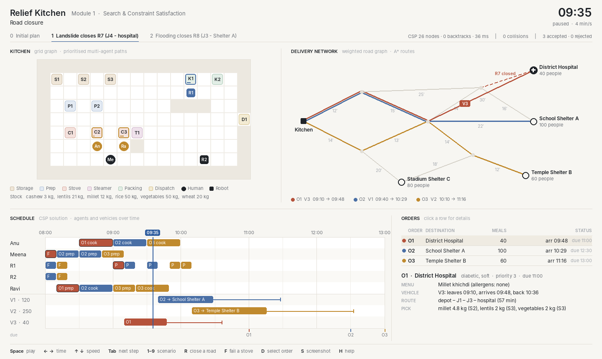

# Module 1: Search and Constraint Satisfaction

Module 1 decides who does what, on which station, by which path, and with which vehicle. It also
decides whether each order can be met, and if not, why. All algorithms are written from scratch
in `relief_kitchen/search_csp/`. Every technique below is either a CS 188 topic or basic graph
theory.


## 1. Graphs

| Graph | Nodes / edges | File |
|---|---|---|
| Kitchen grid | Floor cells, 4-connected. Shelves `S`, prep counters `P`, stoves `C`, steamer `T`, packing tables `K` and the door `D` are not walkable; each is used from its *access cell*. | `env/kitchen_grid.py` |
| Road network | Kitchen, junctions, shelters and the hospital; weighted by travel minutes; roads can close | `env/road_network.py` |
| Task-dependency DAG | Per order: batches of ≤ 50 meals, each running `fetch → prep → cook → pack`. Every pack feeds one `dispatch` node. | `search_csp/task_graph.py` |

## 2. Search

| Problem | Algorithm | CS 188 topic | File |
|---|---|---|---|
| Path for one agent | A\* with the Manhattan heuristic | A\* search | `astar.py` |
| Nearest ingredient shelf or working stove | BFS distances, then sort | BFS | `locate.py` |
| Delivery route; reroute after a closure | Uniform-cost search (Dijkstra) and A\* with a straight-line heuristic | UCS, A\*, admissible heuristics | `routing.py` |
| Collision-free movement of all agents | Prioritised planning: agents planned one by one with A\* over (cell, time) states, avoiding cells and moves already reserved | A\* (state = cell + time) | `mapf.py`, `motion.py` |
| Critical path of an order | Topological sort, then longest path in the DAG | Graph basics | `task_graph.py` |

Prioritised planning is fast but not complete: an unlucky agent order can block a solvable case
(`tests/test_mapf.py` shows one). In the kitchen scenarios it always succeeds, with 0 collisions.

## 3. Task and resource allocation as a CSP

Time is split into 10-minute slots. Variables for each order `O`:

| Variable | Domain |
|---|---|
| `O.variant` | Recipe (meal variant) |
| `O.b<k>.<stage>` | `(agent, station, start slot)` for each batch task |
| `O.dispatch` | `(vehicle, departure slot)` |

Packing agent, station and start into one value keeps every resource rule binary. For example:
"if two tasks use the same stove, their time intervals do not overlap".

| Category | Constraints |
|---|---|
| dietary | Chosen recipe satisfies the diet (`diabetic`, `soft`, `infant`, `nut_free`, `gluten_free`) |
| ingredients | Total ingredient use ≤ stock (global); the fetch shelf stocks the recipe's main ingredient |
| equipment | Station works; station capacity ≥ batch size; station type suits the recipe; one batch per station at a time (workspace occupancy) |
| staff | Agent has the skill; task inside the agent's shift; one task per agent at a time |
| time | Arrival ≤ deadline |
| transport | An open route exists; vehicle big enough; one trip per vehicle at a time |
| safety | Cooked food served within 150 minutes (maximum holding time) |
| collision | Two stations reached from the same floor cell are never used at once |
| priority | A more urgent order leaves first when sharing a vehicle |
| structure | DAG precedence, order release time, end of day. These are facts and are never relaxed. |

**Solver** (`csp.py`, generic; the tests also solve map colouring) works in three steps:

1. **Node consistency.** Unary constraints prune domains.
2. **AC-3** on binary constraints. Precedence has a cheap `revise`, so earliest-start and
   latest-start bounds flow through the DAG.
3. **Backtracking** with **MRV** and a **degree** tie-break, plus **forward checking**.
   - Generic problems use **LCV** for value ordering.
   - The kitchen uses a simpler heuristic instead: earliest start, then nearest station, then
     least-busy agent. LCV would be slow on hundreds of values per task.
   - Variables are taken in phases: menus, then tasks, then vehicles.

**Order acceptance** (`pipeline.py`):
- Orders are added most urgent first.
- After each addition the CSP is re-solved, starting from the previous solution.
- If the CSP fails (or exceeds 3000 search nodes), the order is rejected and diagnosed, and the
  other orders are still served.

## 4. Infeasibility diagnosis (`diagnosis.py`)

**Step 1: direct checks, one per category, without search.**

| Category | Check |
|---|---|
| dietary | Does any recipe satisfy the diet? |
| ingredients | Does a diet-safe recipe fit the stock left after already-accepted orders? |
| equipment | Does every stage have a working station of the right type and size? |
| staff | Is someone with each skill on shift after the order arrives? |
| transport | Is there an open road, and a vehicle big enough? |
| time | Is release + critical path + fastest drive ≤ deadline? |

**Step 2: relax one category at a time.** This runs only if every check passes but the CSP still
fails, which usually means the order competes with accepted orders. The module drops one
category's constraints for this order and re-solves. Every category whose removal lets the order
through is reported as a cause.

Output of `configs/scenarios/infeasible.yaml`:

```text
O2 (Stadium Shelter C, 80 meals): transport    - no open road from the kitchen to Stadium Shelter C (closed: R12, R13)
O3 (School Shelter A, 30 meals): equipment     - Idli sambar needs a steamer (T1 failed)
O6 (School Shelter A, 100 meals): time         - deadline 09:00, but the earliest possible arrival is 09:43 (70 min of kitchen work + 33 min drive)
O4 (Temple Shelter B, 50 meals): ingredients   - no diet-safe menu can be cooked: Millet khichdi (no shelf holds millet)
O5 (School Shelter A, 60 meals): staff         - everyone who can 'cook' is off shift after the order arrives at 13:30
```


## 5. Scenarios (`configs/scenarios/`)

| File | What happens |
|---|---|
| `base.yaml` | 200 meals: hospital (diabetic and soft), Shelter A, Shelter B (nut-free) |
| `demand_surge.yaml` | +80 people at Shelter A, an urgent hospital order, then a stadium order that no longer fits |
| `stove_failure.yaml` | Stoves C2, then C1, fail. Batches shrink to fit the remaining stoves and every order is still served |
| `rice_shortage.yaml` | Rice drops to 12 kg. The CSP picks other diet-safe recipes |
| `road_closure.yaml` | R7, then R8, close. A\* reroutes and arrival times update |
| `dietary.yaml` | Allergen-free, diabetic and infant meals |
| `infeasible.yaml` | One rejected order per cause category |



## 6. Running

```bash
pip install -r requirements.txt
python -m relief_kitchen.run --scenario configs/scenarios/infeasible.yaml   # text report
python -m relief_kitchen.viz --scenario configs/scenarios/road_closure.yaml  # Pygame visualiser
pytest -q
```

Visualiser keys:

| Key | Action |
|---|---|
| `SPACE` | Play / pause |
| `←` / `→` | Move time |
| `↑` / `↓` | Change speed |
| `TAB` | Next event |
| `1`–`9` | Load a scenario |
| `R` | Close a road and re-solve |
| `F` | Fail a stove and re-solve |
| `D` or click | Select an order |
| `S` | Screenshot |
| `H` | Help |
