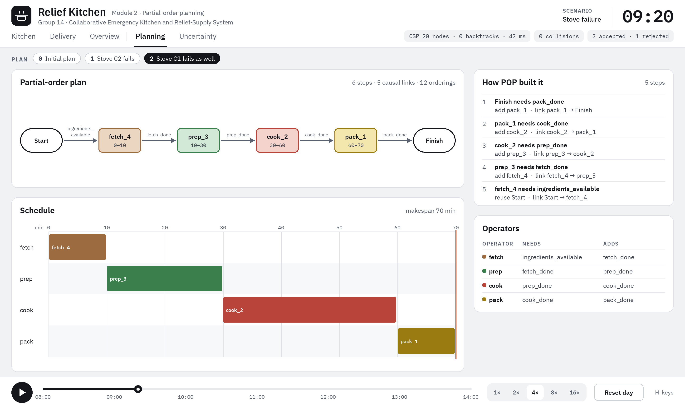
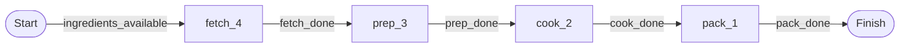

# Module 2: Partial-Order Planning

Module 2 answers the question *in what order must the kitchen work happen, and why?* It turns the
scenario's stages into planning operators. It then builds a **partial-order plan (POP)** that
contains only the orderings it can justify with a causal link. A greedy scheduler puts that plan on
a minute timeline.

Module 1's CSP then makes the detailed decisions: which agent, which station and which 5-minute slot
each batch of each order gets. M2 explains the *logic* of the kitchen: why prep must come after
fetch, and what each step gives the next. That is why the M1 schedule has the shape it has.



## 1. Code map

| File | What is in it |
|---|---|
| `relief_kitchen/planning/partial_order.py` | `Operator`, `Step`, `CausalLink`, `Plan` records and the planner `pop(init, goal, operators, trace=None)` |
| `relief_kitchen/planning/scheduler.py` | `STEP_DURATION` and `schedule(plan)`: greedy earliest start |
| `relief_kitchen/planning/kitchen_plan.py` | `build_operators(stages)`, `problem(sc)` and `plan_for(sc, trace=None)`: builds the problem from a scenario and solves it |
| `relief_kitchen/planning/__main__.py` | The text CLI (`python -m relief_kitchen.run --module m2`) |
| `relief_kitchen/viz/page_planning.py` | The Planning page of the visualiser (key `L`) |

To present the algorithm, show `partial_order.py`. It is about 60 lines of logic, and the loop in
`pop` matches the textbook.

## 2. The planning problem

**Operators.** One operator per stage in the scenario (`stages:` in `base.yaml`). For a stage named
`X` with `after: [Y]`:

- precondition: `Y_done`
- add effect: `X_done`
- delete effect: none

`fetch` has no earlier stage, so `build_operators` gives it the precondition `ingredients_available`.
This gives POP something to link back to the initial state.

| Operator | Preconditions | Adds | Duration (`STEP_DURATION`) |
|---|---|---|---|
| `fetch` | `ingredients_available` | `fetch_done` | 10 min |
| `prep` | `fetch_done` | `prep_done` | 20 min |
| `cook` | `prep_done` | `cook_done` | 30 min |
| `pack` | `cook_done` | `pack_done` | 10 min |

**Initial state and goal** (`problem(sc)`):

- Initial state: `{ingredients_available}`. This becomes the add effect of the dummy step **Start**.
- Goal: `{pack_done}`, the last stage's fact. This becomes the precondition of the dummy step
  **Finish**.

**A plan** is a set of steps (operator instances such as `cook_2`), a set of ordering constraints
`a < b`, and a list of causal links `producer --[condition]--> consumer`.

## 3. The POP algorithm (`pop`)

```
plan = {Start, Finish}, orderings = {Start < Finish}, links = []
loop:
    agenda = open preconditions: (step, condition) pairs not yet supplied by a causal link
    if agenda is empty: return plan                      # complete plan
    take the first (consumer, need)
    achiever = an existing step that adds `need` and is not after consumer   # reuse
               otherwise a new step from an operator that adds `need`        # add
               (a new step S also gets Start < S < Finish)
    add causal link achiever --[need]--> consumer, and ordering achiever < consumer
    for every other step T that deletes `need` (a threat to that link):
        demote:  consumer < T   if that does not create a cycle
        promote: T < achiever   otherwise
```

Two key ideas:

- **Least commitment.** An ordering is added only when a causal link or a threat needs it. Two
  steps that never need each other stay unordered, so they can run in parallel.
- **Threat resolution.** A causal link `A --[c]--> B` is broken if another step that deletes `c` runs
  between A and B. POP moves the threat either after B (demotion) or before A (promotion).

### The real trace for `base.yaml`

`pop(..., trace=[])` records one row per loop iteration. The Planning page shows these rows under
"How POP built it":

| # | Open precondition | Choice | New causal link |
|---|---|---|---|
| 1 | Finish needs `pack_done` | add `pack_1` | `pack_1 → Finish` |
| 2 | pack_1 needs `cook_done` | add `cook_2` | `cook_2 → pack_1` |
| 3 | cook_2 needs `prep_done` | add `prep_3` | `prep_3 → cook_2` |
| 4 | prep_3 needs `fetch_done` | add `fetch_4` | `fetch_4 → prep_3` |
| 5 | fetch_4 needs `ingredients_available` | **reuse Start** | `Start → fetch_4` |

The result has 6 steps, 5 causal links and 12 orderings:

- `Start < Finish`
- `Start < X` and `X < Finish` for each of the 4 steps
- the 3 orderings between the stages

None of these steps threatens another, so no promotions or demotions are needed.

**Why the step numbers count down (`fetch_4 … pack_1`).** POP works *backwards* from the goal. It
first adds the step that achieves `pack_done`, then what *that* step needs, and so on. Step ids get
a counter in the order they are created, so the last stage gets 1.



## 4. Scheduling the plan (`schedule`)

`schedule(plan)` visits the steps in topological order (`Plan.sorted_steps`, Kahn's algorithm). It
gives each step the earliest start that satisfies two rules:

1. **Orderings.** It starts after every predecessor has finished (start + `STEP_DURATION`).
2. **Resources.** Only one task of each operator type runs at a time (`station_free_at[op]`).

| Step | Start | Duration | Finish |
|---|---|---|---|
| fetch_4 | 0 | 10 min | 10 |
| prep_3 | 10 | 20 min | 30 |
| cook_2 | 30 | 30 min | 60 |
| pack_1 | 60 | 10 min | 70 |

The **makespan is 70 minutes**. This is the same "kitchen chain" that Module 1's time diagnosis
uses. In `infeasible.yaml`, an order due at 09:00 is rejected because the chain alone takes 70
minutes of work, before any carrying or driving.

## 5. Running it

```bash
python -m relief_kitchen.run --module m2                       # base scenario
python -m relief_kitchen.run --module m2 --scenario configs/scenarios/stove_failure.yaml
python -m relief_kitchen.planning                              # same thing, run directly
```

Output for `base.yaml`:

```text
=== Module M2: Partial-Order Planning ===
Scenario : Base relief day
Stages   : fetch -> prep -> cook -> pack
Goal     : frozenset({'pack_done'})

Step                    Start    Duration    Finish
----------------------------------------------------
  fetch_4                   0        10 min      10
  prep_3                   10        20 min      30
  cook_2                   30        30 min      60
  pack_1                   60        10 min      70

Causal links (5):
                pack_1 --[pack_done]--> Finish
                cook_2 --[cook_done]--> pack_1
                prep_3 --[prep_done]--> cook_2
               fetch_4 --[fetch_done]--> prep_3
                 Start --[ingredients_available]--> fetch_4

Ordering constraints (non-trivial, 3):
  cook_2 < pack_1
  fetch_4 < prep_3
  prep_3 < cook_2
```

## 6. The Planning page (key `L`)

```bash
python -m relief_kitchen.viz --scenario configs/scenarios/base.yaml    # then press L
```

| Panel | Shows |
|---|---|
| **Partial-order plan** | The plan as a graph. Steps are placed in columns by their depth from Start and coloured like their station type (stores brown, prep green, stove red, packing yellow). Solid arrows are causal links, labelled with the condition they carry. Dashed arrows are extra orderings that no link explains. Each step shows its start and finish minutes. |
| **Schedule** | A Gantt chart of `schedule(plan)` with one row per resource (operator type), a minute axis and the makespan marker. |
| **How POP built it** | The trace above, one row per POP iteration, saying whether the achiever was added or reused, plus any threats it resolved. **Hover a row** to highlight its causal link in the graph. This is the easiest way to explain the algorithm live. |
| **Operators** | Each operator's preconditions and add effects, as built from the scenario's stages. |

**Hover a step** to see its operator, preconditions, add and delete effects, its start and finish
times, and its incoming and outgoing links.

## 7. Limitations (useful for Q&A)

- **One plan per batch, shared by every scenario.** All scenarios use the same four stages, so
  the plan is always the same. Disruptions such as a failed stove change M1's allocation, not this
  plan. M2 shows the precedence structure that every batch follows.
- **No threats in practice.** The operators have no delete effects, so the promote/demote code
  never fires. It is written and traced, and adding a delete effect (for example, `cook` deleting
  `stove_free`) would trigger it.
- **Plan repair is not implemented.** The README's "retract only the affected causal links" idea
  is future work. Today a disruption triggers a full M1 re-solve.
- **The scheduler has one resource per operator type.** It is not per station. The real per-stove,
  per-agent schedule is M1's CSP (see [module1.md](module1.md)).

## 8. Tests

`tests/test_planning_uncertainty.py` checks:

- POP returns the steps in stage order.
- The trace has one row per causal link.
- The schedule never starts a consumer before its producer finishes.

`tests/test_imports.py` imports each planning module on its own, which catches circular imports.
