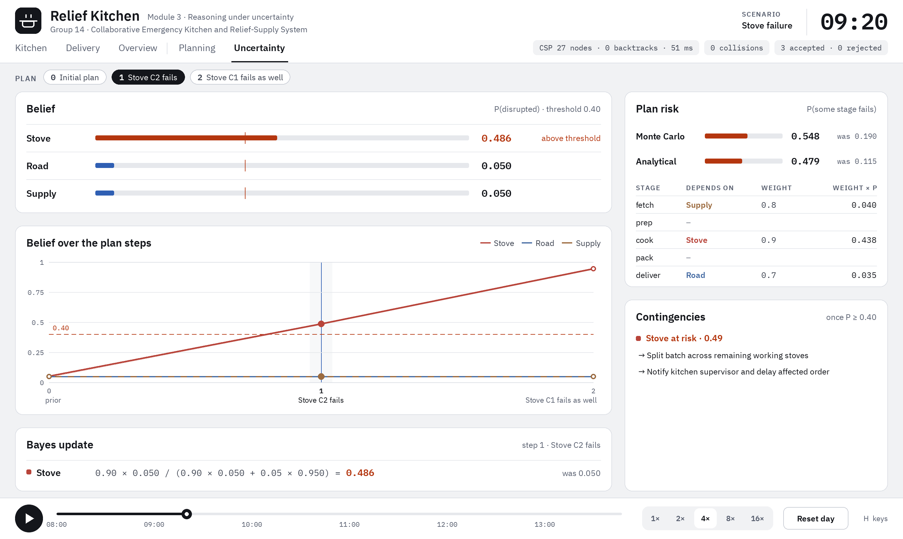

# Module 3: Reasoning under Uncertainty

Module 3 answers *how sure are we that the plan will work?* It keeps a **belief**: a probability
that each kind of resource is disrupted. It updates that belief with **Bayes' rule** whenever a
disruption is observed. It then estimates the **risk** that the plan fails, both analytically and by
**Monte Carlo** sampling. Once a belief crosses a threshold, it suggests **contingency** actions.



## 1. Code map

| File | What is in it |
|---|---|
| `relief_kitchen/uncertainty/belief.py` | `Belief` (the probabilities), the sensor model `P_OBS_GIVEN_FAIL` / `P_OBS_GIVEN_OK`, and `observe_disruption` / `observe_normal` (Bayes updates) |
| `relief_kitchen/uncertainty/risk.py` | `STEP_RISK`, `estimate_risk` (analytical) and `monte_carlo_risk` (sampling; takes an optional seeded `rng`) |
| `relief_kitchen/uncertainty/contingency.py` | `THRESHOLD = 0.4`, the `CONTINGENCIES` table and `suggest_contingency` |
| `relief_kitchen/uncertainty/timeline.py` | `observed_disruptions` (scenario change → observation), `belief_timeline` (belief and risk at every plan step), `STAGE_NAMES`, `EVENT_TO_VAR` |
| `relief_kitchen/uncertainty/__main__.py` | The text CLI (`python -m relief_kitchen.run --module m3`) |
| `relief_kitchen/viz/page_uncertainty.py` | The Uncertainty page of the visualiser (key `U`) |

To present the method, show `belief.py` (the Bayes rule) and `risk.py` (the two risk estimates).

## 2. The belief

There are three random variables, each "is this resource disrupted?":

| Variable | Meaning | Prior |
|---|---|---|
| `stove_ok` | a stove is disrupted | 0.05 |
| `road_ok` | a delivery road is disrupted | 0.05 |
| `supply_ok` | ingredient stock is short | 0.05 |

The names end in `_ok` for historical reasons. The stored value is **P(disrupted)**.

## 3. Bayesian update

**Sensor model.** A disruption report is not perfectly reliable:

| | Value | Meaning |
|---|---|---|
| `P(signal │ disrupted)` | 0.90 | a real failure is reported 90% of the time |
| `P(signal │ ok)` | 0.05 | a false alarm happens 5% of the time |

When a disruption signal arrives for variable X, with current belief p, Bayes' rule gives:

```
                     P(signal | disrupted) · p
P(disrupted | signal) = ───────────────────────────────────────────────
                     P(signal | disrupted) · p + P(signal | ok) · (1 − p)
```

**Worked example (`stove_failure.yaml`).**

- **Step 1, "Stove C2 fails":**
  `0.90 × 0.05 / (0.90 × 0.05 + 0.05 × 0.95) = 0.045 / 0.0925 = 0.486`
- **Step 2, "Stove C1 fails as well":** this starts from 0.486.
  `0.90 × 0.486 / (0.90 × 0.486 + 0.05 × 0.514) = 0.4378 / 0.4635 = 0.945`

One report takes the belief from 5% to about 49%. A second, independent report makes it about 95%.
Sensor reliability matters: with false alarms at 5%, a single report is not yet convincing.

`observe_normal` is the matching update for an "all fine" signal, using 0.10 and 0.95. It lowers
the belief. It is implemented but no scenario uses it yet.

## 4. From scenario events to observations (`timeline.py`)

`observed_disruptions(prev, sc)` compares two consecutive scenario states and reports a signal for:

| Change between the two states | Observation |
|---|---|
| a stove that worked is now failed | `stove_ok` |
| a road that was open is now closed | `road_ok` |
| any shelf now holds less of an ingredient | `supply_ok` |

`belief_timeline(scenarios)` starts from the prior and applies these updates step by step, one step
per entry of the M1 timeline: the initial plan, then one per event. At every step it records:

- the probabilities
- the updates `(variable, prior, posterior)`
- both risk values
- the contingencies.

Because the belief is computed by *comparing scenarios*, disruptions added live in the visualiser
(`R` closes a road, `F` fails a stove) are picked up too.

The CLI (`__main__.py`) is simpler. It applies only the *first* scenario event, mapped through
`EVENT_TO_VAR`. If there are no events, it simulates a stove-failure signal.

## 5. Plan risk

Each plan stage depends on one variable, with a weight: how likely a disruption of that resource is
to actually break the stage (`STEP_RISK`):

| Stage | Depends on | Weight |
|---|---|---|
| fetch | `supply_ok` | 0.8 |
| prep | none | 0 |
| cook | `stove_ok` | 0.9 |
| pack | none | 0 |
| deliver | `road_ok` | 0.7 |

### Analytical risk (`estimate_risk`)

Assuming the stages fail independently, stage i fails with probability `wᵢ · pᵢ`, so:

```
risk = 1 − Π (1 − wᵢ · pᵢ)
```

At the prior: `1 − (1 − 0.8·0.05)(1 − 0.9·0.05)(1 − 0.7·0.05) = 1 − 0.96 · 0.955 · 0.965 = 0.115`.

After step 1 of the stove failure: `1 − 0.96 · (1 − 0.9·0.486) · 0.965 = 0.479`.

### Monte Carlo risk (`monte_carlo_risk`)

1. Sample n = 500 "worlds". In each world, every variable is disrupted with probability p.
2. A world fails if any stage depends on a disrupted variable.
3. The risk is the fraction of worlds that fail.

The visualiser passes `random.Random(0)`, so the numbers are reproducible and don't flicker. The
CLI uses the global random generator, so its Monte Carlo value changes slightly from run to run.

**Why Monte Carlo is higher than analytical.** The sampler ignores the weights. It counts a world as
failed whenever a resource is disrupted, while the analytical formula multiplies by w. So the two
estimate slightly different things:

- the sampler estimates "≥ 1 resource disrupted" (exactly `1 − 0.95³ = 0.143` at the prior)
- the formula estimates "≥ 1 stage actually fails" (0.115).

With only 500 samples there is also sampling noise of about ±0.016 (one standard deviation). Seed 0
happens to give 0.190 at the prior. This is a good point for Q&A: more samples, or weighting each
sampled failure by w, would bring the two closer.

## 6. Contingencies

`suggest_contingency` lists backup actions for every variable with P ≥ **0.40**:

| Variable | Suggested actions |
|---|---|
| `stove_ok` | Split batches across the working stoves; tell the supervisor and delay the affected order |
| `road_ok` | Use an alternate route (re-run routing); dispatch earlier to absorb the extra travel time; use the faster vehicle V3 if capacity allows |
| `supply_ok` | Check the secondary shelf (S3); substitute a recipe (e.g. rice_dal → millet_khichdi); flag the shortage for emergency resupply |

One report (0.486) already crosses 0.40, so contingencies appear after the first disruption.

These suggestions mirror what Module 1 actually does when it re-solves:

- After a stove failure, the CSP moves batches to the remaining stoves.
- After a road closure, A\* finds the alternate route.
- After a rice shortage, the CSP substitutes a diet-safe recipe.

## 7. Results for every scenario

These come from `belief_timeline` with seed 0. "MC" is Monte Carlo with 500 samples, and "An." is
the analytical estimate.

| Scenario | Step | P(stove) | P(road) | P(supply) | MC | An. | Contingency |
|---|---|---|---|---|---|---|---|
| base, dietary, infeasible | 0 (only step) | 0.050 | 0.050 | 0.050 | 0.190 | 0.115 | none |
| demand_surge | 0–3 | 0.050 | 0.050 | 0.050 | 0.190 | 0.115 | none (demand is not a belief variable) |
| stove_failure | 0 initial | 0.050 | 0.050 | 0.050 | 0.190 | 0.115 | none |
| | 1 C2 fails | **0.486** | 0.050 | 0.050 | 0.548 | 0.479 | stove |
| | 2 C1 fails | **0.945** | 0.050 | 0.050 | 0.956 | 0.861 | stove |
| road_closure | 0 initial | 0.050 | 0.050 | 0.050 | 0.190 | 0.115 | none |
| | 1 R7 closes | 0.050 | **0.486** | 0.050 | 0.548 | 0.395 | road |
| | 2 R8 closes | 0.050 | **0.945** | 0.050 | 0.946 | 0.689 | road |
| rice_shortage | 0 initial | 0.050 | 0.050 | 0.050 | 0.190 | 0.115 | none |
| | 1 S1 rice → 6 kg | 0.050 | 0.050 | **0.486** | 0.562 | 0.437 | supply |
| | 2 S3 rice → 6 kg | 0.050 | 0.050 | **0.945** | 0.940 | 0.775 | supply |

The analytical risk rises most for stoves (weight 0.9) and least for roads (weight 0.7). This is
the weights at work.

## 8. Running it

```bash
python -m relief_kitchen.run --module m3                                      # stove_failure by default
python -m relief_kitchen.run --module m3 --scenario configs/scenarios/road_closure.yaml
python -m relief_kitchen.uncertainty                                          # same thing, run directly
```

Output for `stove_failure.yaml` (the Monte Carlo values vary per run):

```text
=== Module M3: Uncertainty & Risk ===
Scenario: Stove failure

--- Initial belief state (before any disruption) ---
Belief state (P(disrupted)):
  stove_ok        0.050  [#                   ]
  road_ok         0.050  [#                   ]
  supply_ok       0.050  [#                   ]

  Monte-Carlo risk : 0.172
  Analytical risk  : 0.115

>>> Disruption observed: Stove C2 fails

--- Updated belief state (after disruption) ---
Belief state (P(disrupted)):
  stove_ok        0.486  [#########           ]
  road_ok         0.050  [#                   ]
  supply_ok       0.050  [#                   ]

  Monte-Carlo risk : 0.538  (was 0.172)
  Analytical risk  : 0.479  (was 0.115)

--- Contingency recommendations ---
  [stove_ok  risk=0.49]
    -> Split batch across remaining working stoves
    -> Notify kitchen supervisor and delay affected order
```

## 9. The Uncertainty page (key `U`)

```bash
python -m relief_kitchen.viz --scenario configs/scenarios/stove_failure.yaml   # press U, then Tab
```

The page follows the **PLAN** step bar at the top. Press `Tab` or `P`, or click a step, to move
through the disruptions.

| Panel | Shows |
|---|---|
| **Belief** | One bar per variable, with a grey tick at the 0.05 prior and a red tick at the 0.40 threshold. A value turns red once it is above the threshold. **Hover a row** to see the sensor model and that variable's value at every step. |
| **Belief over the timeline** | A line chart of the three probabilities over the plan steps, with the dashed 0.40 threshold and the current step marked. Where lines overlap (e.g. road and supply both at 0.05), they are drawn as alternating dashes so both stay visible. |
| **Bayes update** | The formula filled in with this step's numbers, e.g. `0.90 × 0.050 / (0.90 × 0.050 + 0.05 × 0.950) = 0.486`, At step 0 it explains the prior. At a step with no stove, road or stock change it says the belief is unchanged. |
| **Plan risk** | Monte Carlo and analytical risk as bars with their previous-step values ("was …"), and the per-stage table: stage, variable, weight and weight × p. |
| **Contingencies** | The `suggest_contingency` actions for every variable at or above 0.40. |

Try pressing `R` (close a road) or `F` (fail a stove) on this page. A new step appears, and the
matching belief jumps.

## 10. Limitations (useful for Q&A)

- **Failures already in the scenario file are not observations.** `infeasible.yaml` starts with
  millet at 0 kg and two roads closed, but these are part of the initial state, not events, so the
  belief stays at the prior.
- **Demand is not modelled.** The `demand_surge` and `add_order` events don't map to any variable.
- **Every report is treated as a new, independent signal.** Two stove failures raise the same
  `stove_ok` variable, rather than tracking each stove separately.
- **Monte Carlo ignores the weights** (see §5).
- **README ideas not built yet:** Beta–Bernoulli equipment models, a Bayesian network for travel
  times, and confirmed/estimated/forecast provenance tags.

## 11. Tests

`tests/test_planning_uncertainty.py` checks:

- The belief at step 0 is the prior.
- `stove_ok` crosses 0.4 after the first stove failure and rises again after the second.
- Road and supply stay at 0.05 in the stove scenario.
- Road closures map to `road_ok` and stock cuts map to `supply_ok`.
- The seeded Monte Carlo value is reproducible.
